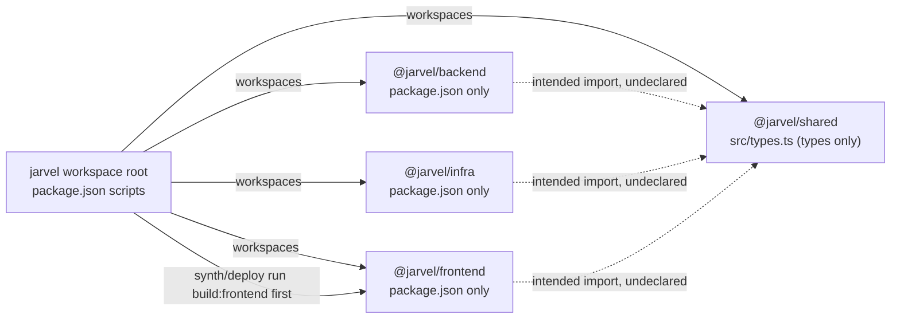
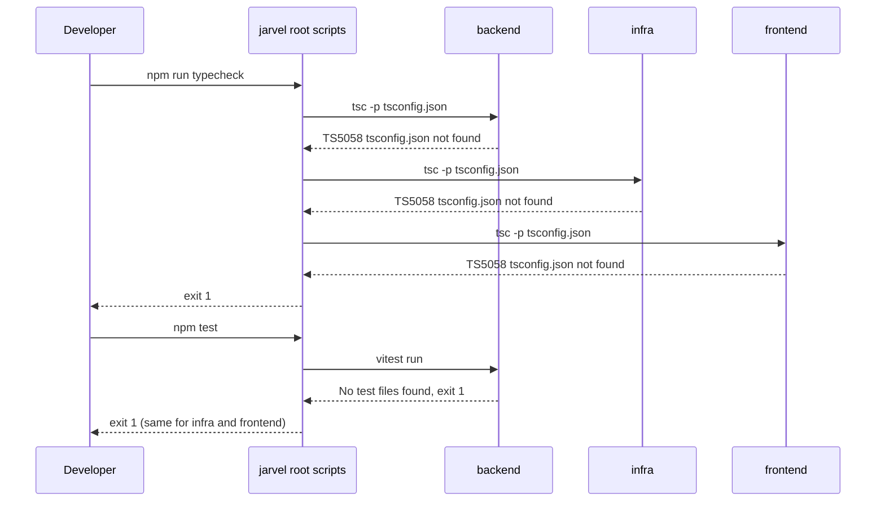
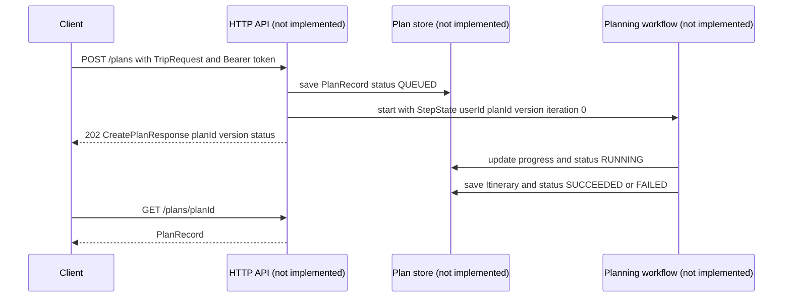

# Architecture

## Architecture Analysis

### System Overview

Jarvel is an npm-workspaces TypeScript monorepo with four packages: `shared`, `backend`, `infra` and `frontend`. Only `@jarvel/shared` contains code: one file of type declarations. `backend`, `infra` and `frontend` are placeholders, each holding only a `package.json` with dependencies chosen and scripts declared. Nothing runs today. The repository has no deployable artifact, no running service and no infrastructure definition.

### Architectural Style

**Not yet established in code.** The dependency choices suggest an intended AWS serverless style: Lambda typings, AWS SDK clients for DynamoDB, S3, Step Functions and Bedrock, the CDK in `infra`, and Amplify in `frontend`. No handler, construct or state machine exists to confirm it. `docs/ARCHITECTURE.md` describes a serverless design (API Gateway, Lambda, Step Functions, DynamoDB, S3, Cognito, CloudFront, Bedrock). It is **described in the doc but not implemented**, and under the project rule it is context only until the person confirms it.

### Component Relationships

What exists today (solid lines: package-manager relationships on disk; dashed lines: intended imports that the type file's header comment states, with no code making them):

Text fallback: the root `package.json` lists four workspaces. The root `synth` and `deploy` scripts build the frontend and then run the infra CDK command. The header of `shared/src/types.ts` says backend, infra and frontend import `@jarvel/shared`, but no file imports it, and no workspace lists it as a dependency.

### Data Flow

No runtime data flow exists. The shared types describe the intended flow. A `TripRequest` creates a `PlanRecord` that moves through `PlanStatus` (QUEUED → RUNNING → SUCCEEDED or FAILED) while `AgentProgress` entries update. Small `StepState` messages pass between workflow steps, and agent outputs are referred to by S3 key (`plans/{planId}/v{version}/{agent}[-{iteration}].json`, `types.ts` lines 374-375). The result is an `Itinerary` attached to the record. Persistence, the workflow engine and the model calls are all **unimplemented**.

### Key Design Decisions

Decisions already fixed in files:
1. **Monorepo with one shared contract package.** `@jarvel/shared` exports raw TypeScript with no build. This works only for consumers that bundle (esbuild, Vite) or type-check with `moduleResolution: Bundler`, which `tsconfig.base.json` sets.
2. **ES modules and strict TypeScript everywhere** (`"type": "module"`, `strict`, `noUncheckedIndexedAccess`, `noEmit`): type checks only, and bundlers produce the output.
3. **AWS-native dependencies chosen before any code** (SDK v3 modular clients, CDK v2, Amplify v6). The chosen clients point to DynamoDB, S3, Step Functions and Bedrock, which is not yet confirmed.
4. **User-scoped plans** (`PlanRecord.userId` is commented as the Cognito subject), which implies JWT-authenticated access.
5. **Small step state, large artifacts kept by key** (`StepState` comment), which keeps workflow payloads small.

### Improvement Opportunities
- Make the toolchain run before any feature work: workspace `tsconfig.json` files that extend the base, declared `@jarvel/shared` dependencies, and runnable test scripts. Details in [code-quality-assessment.md](code-quality-assessment.md).
- Replace the commented route list with an executable contract (zod schemas or OpenAPI) shared by handlers and tests.
- Bring the shared contract into line with the approved scope: invitation and access control, the per-person monthly quota, and either drop revise and `FrontendConfig` or mark them as later work.
- Choose the architecture during Inception with trade-offs recorded. The ARCHITECTURE.md design is one input to discuss, not a decision.

## Interaction Diagrams

### 1. Workspace script run (implemented and verified 2026-10-22)

Text fallback: the root runs each workspace's `typecheck` script in turn, and every one fails because it has no `tsconfig.json`. `npm test` runs `vitest run` in each workspace, and every one exits with code 1 because there are no test files. `shared` has no scripts and is skipped (`--if-present`).

### 2. Create a plan (declared in the shared contract, no implementation)

Text fallback: `shared/src/types.ts` declares that `POST /plans` accepts a `TripRequest` and returns `202 { planId, version, status }`, and that `GET /plans/{planId}` returns the `PlanRecord`. `StepState` and `PlanStatus` imply an asynchronous workflow that updates the record. Every participant in this sequence is unimplemented. The diagram shows the contract only.
