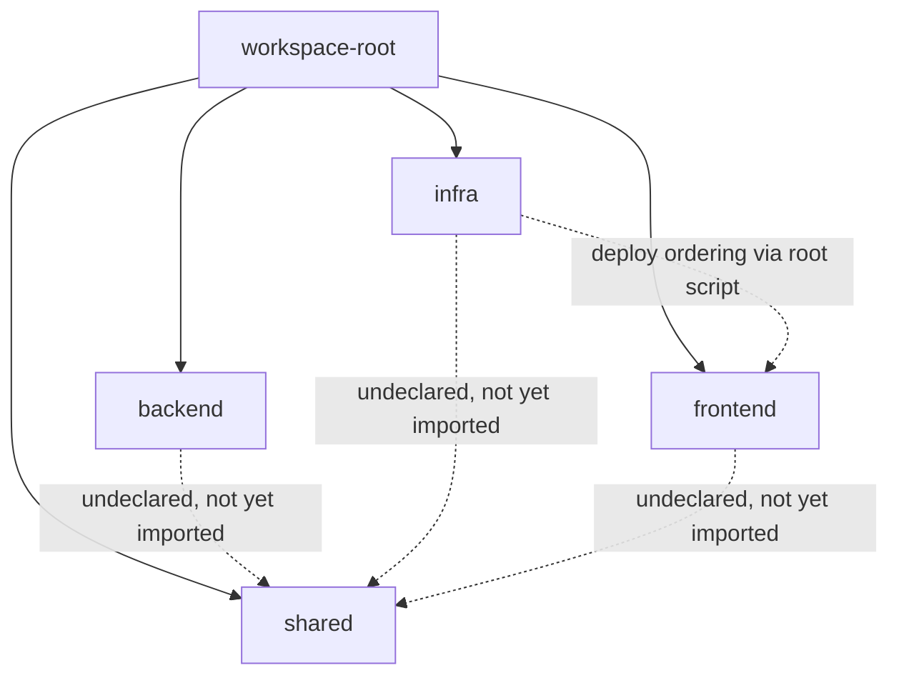

# Dependencies

Versions are listed once, in [technology-stack.md](technology-stack.md). This file covers how packages relate.

## Internal (cross-package) Dependencies

| From | To | Declared? | Evidence |
|---|---|---|---|
| root `jarvel` | `shared`, `backend`, `infra`, `frontend` | Yes (`workspaces`) | `package.json` line 5 |
| root `synth` / `deploy` | `frontend` build, then `infra` | Yes (script chain) | `package.json` lines 11-12 |
| `backend` | `@jarvel/shared` | **No** | Intended per the `types.ts` header; no import yet |
| `infra` | `@jarvel/shared` | **No** | Same as above |
| `frontend` | `@jarvel/shared` | **No** | Same as above |
| `infra` (deploy) | `frontend/dist` | Implied | Root `deploy` builds the frontend first; no CDK code consumes it yet |

npm links every workspace into `node_modules/@jarvel/*` (lockfile lines 1753-1767), so an import of `@jarvel/shared` would resolve even though no package declares it. If backend, infra or frontend were installed or bundled on its own, that import would break. Declare `"@jarvel/shared": "*"` in each consumer.

Text fallback: the root depends on all four workspaces. Infra deploys after the frontend builds. Backend, infra and frontend are meant to depend on shared, but none declares it or imports it.

## External Dependencies by Package

| Package | Runtime dependencies | Dev dependencies |
|---|---|---|
| shared | none | none |
| backend | 5 AWS SDK v3 packages, zod | @types/aws-lambda, @types/node, esbuild, typescript, vitest |
| infra | aws-cdk-lib, constructs | @types/node, aws-cdk, esbuild, tsx, typescript, vitest |
| frontend | react, react-dom, aws-amplify, @aws-amplify/ui-react, leaflet, react-leaflet | testing-library ×2, @types ×3, @vitejs/plugin-react, jsdom, typescript, vite, vitest |

## External Services Referenced (no client code)

| Service | Where referenced | Integration status |
|---|---|---|
| AWS DynamoDB, S3, Step Functions, Bedrock | backend dependencies | Not implemented |
| AWS Cognito | `PlanRecord.userId` comment, `FrontendConfig` | Not implemented |
| Analyze Boston CKAN (crime incidents) | `SafetyKnowledge.crimeApi` | Not implemented |
| US National Weather Service | `WeatherSummary.source` | Not implemented |
| OpenStreetMap tiles (through Leaflet) | frontend dependency | Not implemented |

## Dependency Health
- All direct dependencies are pinned in the lockfile, and every resolved version equals the declared minimum. No duplicate majors of the direct dependencies were found.
- `@types/node` 26 is newer than the `engines` floor of Node 22, so APIs that exist only in newer Node versions could pass the type check and then fail on a Node 22 runtime.
- No vulnerability audit was run in this scan. Run `npm audit` before Construction.
