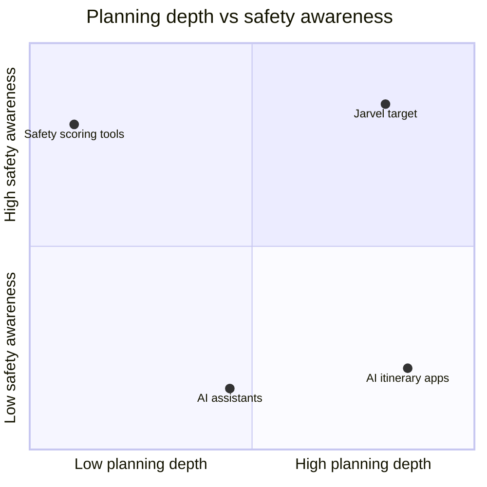

# Competitive Analysis: Jarvel

Builds on the approved intent statement (`ideation/intent-capture/intent-statement.md`): a free, public trip planner for any city that puts safety first, keeps a relaxed pace, prefers public transport and estimates cost.

## Competitors

| Group | Examples | What they do | Source |
|-------|----------|--------------|--------|
| General AI assistants | ChatGPT, Google Gemini | Write an itinerary from a chat prompt; no built-in checks on hours, safety or pace | Answer Q1; Gemini listed among trip planners by [Lindy](https://www.lindy.ai/blog/trip-planner-app) |
| AI itinerary apps | Mindtrip, Layla, Wanderlog | Generate and organise itineraries; Mindtrip and Layla lean towards booking, Wanderlog towards map-based editing and group planning | Answer Q1; [Lindy](https://www.lindy.ai/blog/trip-planner-app), [Unite.ai](https://www.unite.ai/?p=319272) |
| Safety-scoring tools | TripIt Neighborhood Safety Scores, GeoSure | Score neighbourhoods for safety (TripIt 1 to 100; GeoSure includes day vs night); they do not build an itinerary around the scores | Answer Q1; [Techlicious on TripIt](https://www.techlicious.com/blog/tripit-neighborhood-safety-scores-international-travel-tips), [We3Travel](https://we3travel.com/?p=120967) |

Most published comparisons are written by competing vendors, and they disagree on details (for example, whether Wanderlog has expense tools). Treat feature claims below as vendor-reported unless confirmed hands-on.

## Feature Comparison

Ratings: Strong / Adequate / Weak / Absent, based on the sources above. "Jarvel (target)" is the intended position, not a built product.

| Capability | Jarvel (target) | AI assistants | AI itinerary apps | Safety-scoring tools |
|------------|-----------------|---------------|-------------------|----------------------|
| Itinerary generation | Strong | Adequate | Strong | Absent |
| Safety checked hour by hour inside the plan | Strong (Q2) | Absent | Weak or absent (not reported in sources) | Adequate for scores only, no plan |
| Relaxed pace enforced by rules | Strong (Q2) | Weak | Weak (not reported) | Absent |
| Public-transport-first, last-train aware | Strong (Q2) | Weak | Weak (not reported) | Absent |
| Trip cost estimate | Adequate (Q2) | Weak | Adequate (Wanderlog expense tools per Unite.ai; disputed by Stippl) | Absent |
| Map of each day | Table stakes (Q3) | Absent | Strong | Adequate (maps of scores) |
| Booking links | Table stakes (Q3) | Weak | Strong (Mindtrip, Layla) | Absent |
| Sharing with companions | Table stakes (Q3) | Weak | Strong (Wanderlog) | Absent |
| Price to the traveler | Free now, maybe paid later (Q5) | Free tier plus subscription | Free tiers; some require login first ([MonkeyTravel](https://monkeytravel.app/pt/blog/mindtrip-alternative-2026)) | Free/paid app |

## Positioning

- Jarvel's chosen difference is combining two things the market keeps apart: itinerary apps plan but do not check safety by time of day, and safety tools score areas but do not plan (Answer Q2; sources above).
- The four differentiators are hourly safety, a rules-enforced relaxed pace, transit-first plans that know the last train, and a cost estimate (Answer Q2).
- Map, opening hours, booking links and sharing are table stakes; without them Jarvel would look incomplete next to Wanderlog or Mindtrip (Answer Q3).

<!-- Text fallback: AI assistants sit at medium planning depth and low safety awareness; AI itinerary apps at high planning depth and low safety awareness; safety-scoring tools at low planning depth and high safety awareness; Jarvel targets high planning depth and high safety awareness, an underserved corner. Positions are judgement, not measured data. -->

The positions in the chart are a judgement from the sources above, not measured data.

## Assumptions & Open Questions

- Hypothesis: no competitor combines hour-by-hour safety checks with itinerary generation. This is based on vendor-written roundups and app listings only; a hands-on check of Mindtrip, Layla and Wanderlog would confirm it.
- Safety scores outside the US depend on each country's available data (noted for several tools in the search results); Jarvel faces the same limit, which is why the intent says to warn when safety was not checked.
