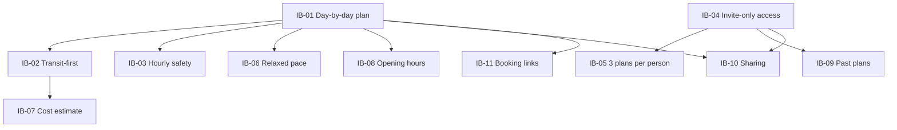

# Intent Backlog: Jarvel, Nov 18 Version

Built from the scope document (`scope-document.md`), the approved intent statement (`ideation/intent-capture/intent-statement.md`), the feasibility assessment (`ideation/feasibility/feasibility-assessment.md`), the constraint register (`ideation/feasibility/constraint-register.md`) and the answers in `scope-definition-questions.md`.

Each item is a candidate piece of work (a proto-Unit). Items are ranked with MoSCoW: Must, Should, Won't (this time). Inside each group, the order follows the value-first choice [Q5].

## Backlog

| Rank | ID | Item | Priority | Depends on | Target | Source |
|------|----|------|----------|-----------|--------|--------|
| 1 | IB-01 | Day-by-day plan for a Boston trip from dates, hotel and wishlist | Must | — | Nov 1, 2026 | S-01; [Q3] [Q5] [Q8] |
| 2 | IB-02 | Public-transport-first travel between stops, aware of the last train | Must | IB-01 | Nov 18, 2026 | S-03; [Q3] [Q9] |
| 3 | IB-03 | Hourly safety check using hand-checked Boston safety information | Must | IB-01 | Nov 18, 2026 | S-02; [Q3] [Q9] |
| 4 | IB-04 | Invite-only access | Must | — | Nov 18, 2026 | S-04; [Q2] |
| 5 | IB-05 | Limit of 3 plans per person per month | Must | IB-04 | Nov 18, 2026 | S-05; [Q7] [C-05] |
| 6 | IB-06 | Relaxed pace enforced by rules | Should | IB-01 | If time remains | S-06; [Q9] |
| 7 | IB-07 | Trip cost estimate | Should | IB-01, IB-02 | If time remains | S-07; [Q9] |
| 8 | IB-08 | Opening hours checked for every stop | Should | IB-01 | If time remains | S-08; [Q9] |
| 9 | IB-09 | Seeing and deleting my past plans | Should | IB-04 | If time remains | S-09; [Q9] [C-12] |
| 10 | IB-10 | Sharing a plan with travel companions | Should | IB-01, IB-04 | If time remains | S-10; [Q9] |
| 11 | IB-11 | Booking or reservation links | Should | IB-01 | If time remains | S-11; [Q9] |
| — | IB-12 | Cities other than Boston, with the "safety not checked" warning | Won't (this time) | — | Later version | [Q1] [C-15] |
| — | IB-13 | Public self sign-up | Won't (this time) | IB-04 | Later version | [Q2] |
| — | IB-14 | Total monthly plan limit across all users | Won't (this time) | IB-05 | Later version | [Q7] |
| — | IB-15 | Revising an existing plan | Won't (this time) | IB-01 | Later version | [C-16] |
| — | IB-16 | The web app the traveler uses | Won't (this time) | — | Later version | [C-16] |

## Why This Order

- IB-01 comes first because the requester wants a working plan for their own trip by Nov 1, 2026 [Q5] [Q8].
- IB-02 and IB-03 complete the must-have plan quality: transit-first and hourly safety were kept as must-have [Q9].
- IB-04 and IB-05 come after the Nov 1 checkpoint, because the checkpoint is for the requester's own use; they must still work before other invited people use the planner by Nov 18 [Q2] [Q7].
- The order of the should-haves (IB-06 to IB-11) is a suggestion. Only "should-have" was chosen [Q9], not an order among them; change it at approval if you want a different one. IB-06 and IB-07 come first among them because public users asked for a relaxed pace and a cost estimate [intent statement].

## Dependencies Between Items

Text version: the plan (IB-01) comes before transit-first (IB-02), hourly safety (IB-03), relaxed pace (IB-06), opening hours (IB-08), sharing (IB-10) and booking links (IB-11). Transit-first (IB-02) comes before the cost estimate (IB-07). Invite-only access (IB-04) comes before the plan limit (IB-05), past plans (IB-09) and sharing (IB-10).

## Assumptions & Open Questions

- Assumption: building time (under about 45 hours [C-02]) covers the five must-haves; whether any should-have fits is unknown until the must-haves are built.
- Open question for Delivery Planning: how many hours each item takes is not estimated here.
