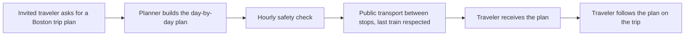

# Scope Document: Jarvel, Nov 18 Version

Inputs: the approved intent statement (`ideation/intent-capture/intent-statement.md`), the feasibility assessment (`ideation/feasibility/feasibility-assessment.md`), the constraint register (`ideation/feasibility/constraint-register.md`) and the answers in `scope-definition-questions.md`.

## Why the Scope Was Cut

The approved first version was a free, public trip planner for any city [intent statement]. Feasibility found that this does not fit in under about 45 hours of building time and $25 per month by Nov 18, 2026 [feasibility assessment] [C-02] [C-03]. The approved rule is to keep the date and cut the scope [C-01]. This document records what was cut.

The choice is a combination of feasibility options A (few cities first) and C (private first): Boston only, invite-only [Q1] [Q2] [feasibility assessment, option D].

## In Scope by Nov 18, 2026

### Must-have

| ID | Capability | Source |
|----|------------|--------|
| S-01 | A day-by-day plan for given dates, hotel and wishlist, for trips in Boston | [Q1] [Q3] [Q9] |
| S-02 | Safety checked hour by hour, using hand-checked Boston safety information | [Q1] [Q3] [Q9] |
| S-03 | Public-transport-first travel between stops, aware of the last train | [Q3] [Q9] |
| S-04 | Invite-only access: only invited people can use the planner | [Q2] |
| S-05 | At most 3 plans per person per month | [Q7] [intent statement] [C-05] |

### Should-have (built only if time remains after the must-haves)

| ID | Capability | Source |
|----|------------|--------|
| S-06 | A relaxed pace enforced by rules | [Q3] [Q9] |
| S-07 | An estimate of what the trip will cost | [Q3] [Q9] |
| S-08 | Opening hours checked for every stop | [Q4] [Q9] |
| S-09 | Seeing and deleting my past plans | [Q4] [Q9] |
| S-10 | Sharing a plan with travel companions | [Q4] [Q9] |
| S-11 | Booking or reservation links | [Q4] [Q9] |

## Out of Scope for Nov 18, 2026

| Item | Why | Source |
|------|-----|--------|
| Cities other than Boston | Free data for safety, transit and opening hours is patchy elsewhere | [Q1] [feasibility assessment] |
| Public self sign-up | Moved to a later version; invite-only at launch | [Q2] |
| The "safety not checked" warning for cities without safety knowledge | Only Boston is planned, and Boston has hand-checked safety information | [Q1] [C-15] |
| A total monthly plan limit across all users | Not wanted; the per-person limit stays and cost is watched | [Q7] |
| The web app the traveler uses | Already out in the approved intent | [C-16] [intent statement] |
| Revising an existing plan | Already out in the approved intent | [C-16] [intent statement] |

## Minimum Viable Scope

The smallest version that delivers value is the must-have list (S-01 to S-05): an invited person in Boston asks for a trip and gets a day-by-day plan that keeps them safe hour by hour and gets them around by public transport [Q3] [Q9].

## Sequencing and Dates

The order is value first: a working plan for the requester's own trip as early as possible [Q5].

| Date | What works | Source |
|------|-----------|--------|
| Nov 1, 2026 | A first working plan for the requester's own Boston trip | [Q6] [Q8] |
| Nov 18, 2026 | All must-haves (S-01 to S-05); should-haves only if time remains | [Q9] [C-01] |

## Value Stream

How a traveler gets value from this version, from request to trip:

Text version: an invited traveler asks for a Boston trip plan; the planner builds a day-by-day plan; each hour is checked against Boston safety information; travel between stops uses public transport and respects the last train; the traveler receives the plan and follows it on the trip.

## Success Metrics for This Version

These are the approved metrics [intent statement], narrowed to the cut scope.

| Metric | Target | Source |
|--------|--------|--------|
| Time to receive a complete itinerary | Under 5 minutes from the request | [intent statement] [C-09] |
| Safety rules broken in a returned Boston plan | Zero | [intent statement] |
| Must-see wishlist places covered | 100% either scheduled or listed with a reason they could not fit | [intent statement] |
| Total running cost | Under $25 per month | [C-03] |
| Plans per person | At most 3 per month | [C-05] [Q7] |
| First plan for the requester's trip | Works by Nov 1, 2026 | [Q8] |
| Must-haves | Work by Nov 18, 2026 | [Q9] [C-01] |

## Assumptions & Open Questions

- Assumption: with no total monthly limit [Q7], the $25 cap holds only while few people are invited. At the feasibility estimates of $0.10 to $0.30 per plan and about $15 per month left for AI [feasibility assessment], 3 plans per person fits roughly 16 to 50 invited people. This is an estimate, not a measurement.
- Assumption: the earlier unmeasured guesses still apply (tokens per plan, about $10 per month for hosting and tests) [feasibility assessment, A-01, A-02].
- Open question for Requirements Analysis: privacy rules require that people can get their data deleted [C-12], while "seeing and deleting my past plans" (S-09) is only should-have. How deletion is handled for invited people if S-09 is not built needs an answer.
- Open question for Requirements Analysis: who sends invitations, and how, is not yet decided [Q2].
